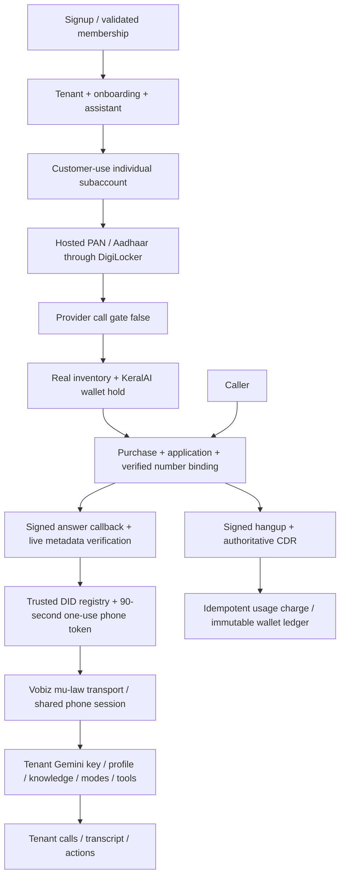

# Managed voice architecture

KeralAI keeps Better Auth, shared Neon tenancy, encrypted per-tenant Gemini/CRM credentials, knowledge, modes and the existing Gemini session. Managed telephony is an additive domain, not a replacement application.

## Boundaries

`lib/telephony/types.ts` defines `TelephonyProvider`; `provider.ts` selects the adapter. Customer APIs operate on account/KYC/numbers/usage/wallet, never arbitrary provider IDs. `service.ts` owns orchestration; Vobiz HTTP/schema/signature/XML behavior is in `providers/vobiz`. This beta selects Vobiz; adding another provider requires implementing its adapter and factory selection, not rewriting tenant tables.

The bridge retains one `CallSession`. `transports/vobiz.mjs` converts protocol and G.711 mu-law, and `exotel-legacy.mjs` preserves PCM legacy installations. Browser voice remains its existing separate relay. No SIP infrastructure is introduced. Both services use tenant-scoped Gemini credentials; the bridge receives no Vobiz master credentials.

The trusted DID lookup in inbound callbacks is intentionally global so it can resolve tenant context. Provider account/session lookups in KYC callbacks are similarly global identifiers authenticated by provider HMAC. Scheduled reconciliation and allowlisted administrator queries are explicit control-plane exceptions. All customer data access is scoped by validated membership, never a client tenant ID.

## Verified provider contracts

Verified through the official documentation MCP on 2026-10-10, using installed sub-account/partner/number/audio/XML/application/call/CDR skills. Primary references: [OpenAPI and docs index](https://www.vobiz.ai/docs/llms.txt), [callback verification](https://www.vobiz.ai/docs/concepts/validating-callbacks), [application creation](https://www.vobiz.ai/docs/applications/create-application), [number attachment](https://www.vobiz.ai/docs/applications/attach-number), [stream initiation](https://www.vobiz.ai/docs/xml/stream/initiate), [KYC sessions](https://www.vobiz.ai/docs/partner/api/kyc-sessions).

| Operation | Path after `https://api.vobiz.ai/api/v1` | Credentials |
| --- | --- | --- |
| Create customer | `/accounts/{MA}/sub-accounts/` | Parent |
| Read customer | `/accounts/{MA}/sub-accounts/{SA}` | Parent |
| Hosted session | `/sub-accounts/{SA}/kyc-sessions` | Parent |
| KYC status | `/sub-accounts/{SA}/kyc/status` | Parent |
| Inventory | `/Account/{MA}/inventory/numbers` | Parent |
| Purchase | `/Account/{SA}/numbers/purchase-from-inventory` | Encrypted SA runtime credentials |
| Owned numbers / release | `/Account/{SA}/numbers` / `/numbers/{encoded E164}` | SA |
| Create application | `/Account/{SA}/Application/` | SA |
| Attach number | `/Account/{SA}/numbers/{encoded E164}/application` | SA |
| Live metadata | `/Account/{SA}/Call/{UUID}?status=live` | SA |
| Completed CDR | `/Account/{SA}/cdr/{UUID}` | SA |

SA purchase charges the parent's provider balance and directly owns the DID; there is no separate transfer step. Credentials are encrypted using existing AES-256-GCM tenant secrets.

## Documentation discrepancies and release gate

- Skills describe playback matching inbound codec; current streaming docs permit multiple playback codecs. We use mu-law 8 kHz both ways, satisfying both contracts.
- Some skill examples describe L16 at 24 kHz; current initiation docs limit inbound L16 to 8/16 kHz. This adapter does not use L16.
- Live-call narrative examples include a trailing slash; current OpenAPI defines the GET without it. Adapter follows OpenAPI.
- Callback configuration examples use lowercase plural application paths, while the specific application docs/OpenAPI use `Application/`. Adapter follows the specific contract.
- Callback introduction says every request has signatures, but its security note says signatures are emitted only when callback URL auth credentials are configured. The published create-application schema does not specify a separate callback credential field. This remains an account-specific provider verification requirement; no field was invented. `VOBIZ_CALLBACK_SIGNATURES_VERIFIED=1` is an operator readiness attestation after testing real signed callbacks. Until then activation, retries, operator resume, incoming answers and bridge phone authorization are disabled. The app and bridge must both have the attestation. Never disable verification to work around missing headers.
- Hosted KYC docs differ on whether `account_auth_id` is populated automatically. We include the field required by OpenAPI.

## Media behavior

Answer XML uses bidirectional inbound `audio/x-mulaw;rate=8000`, keeps the call alive, disables stream retries (tokens are one use), and finishes with Hangup. Incoming `start.callId` must equal the signed provider call, with supported media format and a stable stream ID. Incoming media is decoded to PCM before the existing resampler/VAD pipeline. Gemini PCM is encoded to mu-law; outbound `playAudio` frames are 20 ms. Barge-in sends `clearAudio`. Graceful goodbye uses a playback checkpoint and bounded timeout before `stop`. Budget exhaustion terminates the WebSocket immediately. Payloads are capped at 64 KiB.

Actual audio quality, cold-answer latency, long-call limits and carrier hangup timing require the live acceptance test. Unit/mock tests cannot substitute for that measurement. The safety budget leaves 30 seconds below the reserved rounded-minute allowance; provider CDR is still the financial source, so extraordinary provider termination delays can produce a negative wallet, which prevents further calls and requires operator review.

## Current beta scope

Inbound media is wired. Outbound REST is an adapter capability but has no customer route/UI; enabling it requires caller-ID authorization, reservation and equivalent accounting. Payments are deliberately disabled; beta credit is an audited ledger adjustment. Recording webhooks/storage are not enabled. Existing legacy Exotel records/configuration/routes remain available under Advanced and must not be deleted until live Vobiz acceptance succeeds.

## Live validation corrections

Current release documentation/OpenAPI specifies a paid standard release with `pending_release` and a 24-hour cancellation window, followed by quarantine. HTTP 200 means initiated, not released. KeralAI now keeps `releasing/release_unknown` and reserves an outstanding setup hold until owned-number reads confirm removal; retries never repeat DELETE. Immediate release is not requested. Cancellation is an explicit provider/operator action and routing must be restored separately. Account-specific release fees and commitments need commercial approval. KYC status now also requires `business_type=individual`, so an externally changed entity cannot silently pass the individual gate. See [live sign-off](./live-vobiz-signoff.md).

## Closed-alpha AI credential mode

The user-authorized alpha may use one server-only platform Gemini key on both services. Each workspace still resolves its own profiles, knowledge, modes, tools, transcripts and calls. Platform access requires an invited active owner and a daily tenant allowance; phone setup/answer now use the same credential resolver. Vobiz ownership, KYC, webhook authentication, wallet billing and readiness gates are unchanged. This is not live-provider sign-off; see [alpha setup](./closed-alpha.md).
